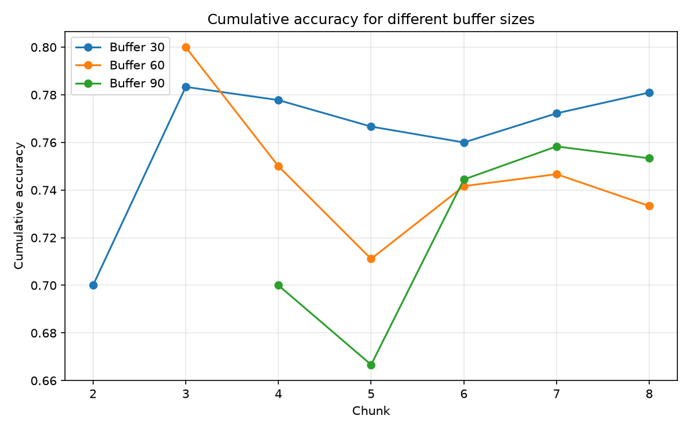
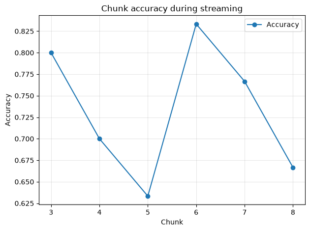
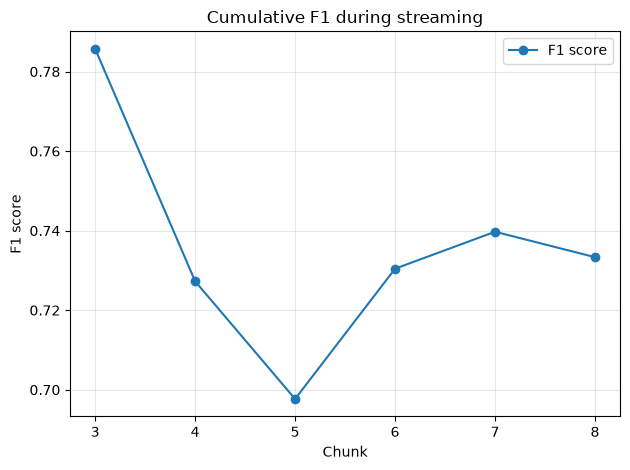
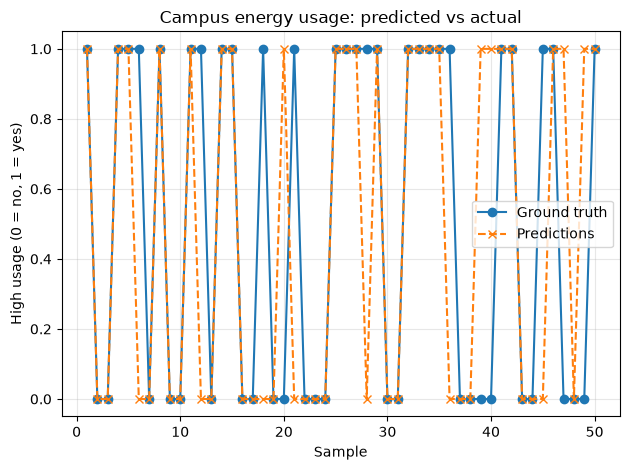
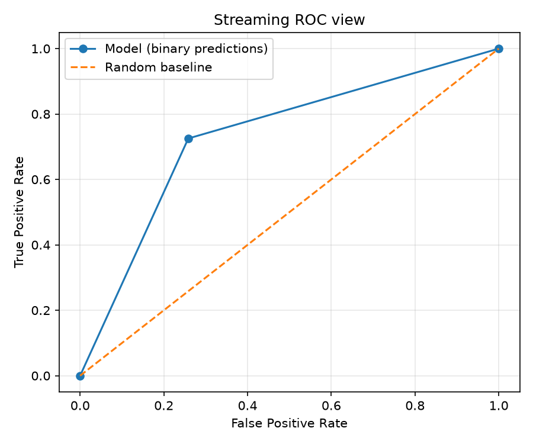

# Assignment_2.2 - Programming for AI (COMP5004)

#### Presented By: Santrupth Shivanna - 3224110

# NumCompute Stream

NumCompute Stream extends on our NumCompute toolkit from previous Assignment. In this assignment, it includes streaming preprocessing, a decision tree that retrains after collecting a set number of samples, metrics to track performance as new data arrives and some visualization plots. And the dataset used is synthetic and is only used to demonstrate the package.

## Main features

- Read CSV files in chunks
- Preprocess numerical and categorical features
- Update the pipeline as new data arrives
- Retrain the decision tree using a configurable buffer size
- Track accuracy, precision, recall, F1 and ROC-AUC
- Compare performance with different plots and benchmark scripts

## Project structure

```text
Assignment-2.2-3224110/
├── numcompute_stream/
├── tests/
├── assets/
│   └── demo.csv
├── demo/
│   ├── stream_demo.ipynb
│   └── outputs/
├── benchmark/
└── README.md
```

## Setup

Run these commands from the project root:

```bash
python -m pip install numpy matplotlib jupyter pytest
```

If a `requirements.txt` file is provided, you can install the dependencies with:

```bash
python -m pip install -r requirements.txt
```

## Run the demo

Open the notebook:

```bash
jupyter notebook demo/stream_demo.ipynb
```

The notebook reads the dataset in chunks. Each chunk is evaluated using the current model before it is used to update the pipeline. The decision tree retrains when its buffer reaches the configured size. Until the first tree is trained, predictions are unavailable.

The plots below show examples from the streaming demo.

### Buffer-size comparison



The plot compares cumulative accuracy for buffer sizes 30, 60, and 90. The accuracy changes as more chunks are processed, and no single buffer size is best at every point.

### Accuracy and F1 over time





These plots show how the model's results change during streaming, rather than reporting only one final score.

### Predictions and ROC view





The prediction plot compares model outputs with the actual labels. The ROC plot gives another view of how the model separates the two classes. In this demo, the ROC view uses binary predictions, so it is a simple illustration rather than a full score-based ROC analysis.

## Benchmarks

Run the benchmark scripts from the project root. Each script saves its results in the `benchmark/` folder.

### Python loops compared with NumPy

For 100,000 values, the measured results were:

| Operation | Loop time (s) | NumPy time (s) | Speedup |
|---|---:|---:|---:|
| Mean | 0.008647 | 0.000042 | 203.93× |
| Square | 0.014289 | 0.000275 | 51.92× |
| Euclidean distance | 0.027949 | 0.000466 | 60.03× |

Run:

```bash
python -m benchmark.benchmarking
```

Output: `benchmark/benchmark_results.csv`

### Decision-tree best-split comparison

| Samples | Loop time (ms) | Vectorised time (ms) | Speedup |
|---:|---:|---:|---:|
| 100 | 47.022 | 0.510 | 92.20× |
| 500 | 430.367 | 1.142 | 376.99× |
| 1,000 | 693.382 | 1.299 | 533.74× |
| 2,000 | 1,754.108 | 2.205 | 795.41× |

In these runs, the vectorised split calculation was faster for each tested sample size.

Run:

```bash
python -m benchmark.benchmark_tree_split
```

Output: `benchmark/tree_split_results.csv`

### Buffer-size comparison

| Buffer size | Retrains | Total fit time (ms) | Accuracy |
|---:|---:|---:|---:|
| 30 | 10 | 27.643 | 0.839 |
| 60 | 5 | 22.950 | 0.883 |
| 120 | 2 | 14.851 | 0.917 |

For this run, buffer size 120 had the highest accuracy and lowest total fit time, while retraining fewer times. Results may differ on another machine or dataset.

Run:

```bash
python -m benchmark.benchmark_buffer_size
```

Output: `benchmark/buffer_size_results.csv`

## Run tests

```bash
python -m pytest
```
